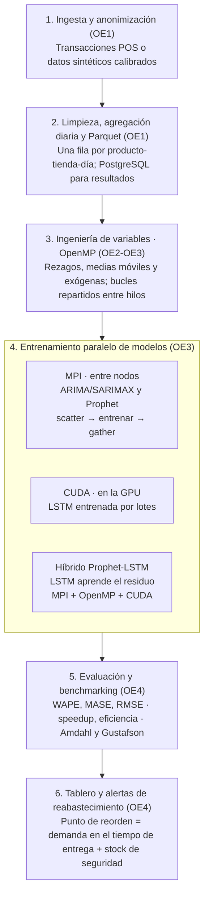

# Guía del sistema: predicción de demanda con ML y cómputo paralelo

Documento de apoyo para la ponencia: explica paso a paso qué hace el sistema, cómo funciona y cómo presentarlo.

## 1. Visión general: qué hace el sistema

En una frase: el sistema toma el historial de ventas de miles de productos en tiendas de Cúcuta y entrena en paralelo modelos de pronóstico. Luego entrega, para cada producto y tienda, la demanda esperada de los próximos días y una alerta de cuándo reabastecer.

**El problema.** Las MIPYMES de abarrotes, ropa y calzado del área metropolitana de Cúcuta se quedan sin stock o acumulan inventario inmovilizado. La causa es que su demanda es muy volátil: depende de la tasa peso-bolívar-dólar, del flujo migratorio, de las quincenas y de la informalidad. Para pronosticarla bien hay que entrenar un modelo por cada combinación producto-tienda, y son miles de series. Hacerlo en secuencial tarda demasiado. Por eso se paraleliza.

**La idea clave para la ponencia.** El machine learning es el caso de uso; lo que se evalúa es el **paralelismo**. El objetivo es mostrar cuánto tiempo se ahorra al repartir el trabajo entre hilos (OpenMP), procesos en varios nodos (MPI) y la GPU (CUDA), sin perder precisión.

**Pregunta de investigación.** ¿Cómo influye el uso de modelos de ML paralelizados (OpenMP, MPI, CUDA) en la precisión y en el tiempo de obtención de las predicciones?

| Hipótesis | Qué afirma | Cómo se comprueba |
| --- | --- | --- |
| H1 | Paralelizar reduce el tiempo de entrenamiento sin degradar la precisión | Tiempos secuencial vs paralelo; error igual o equivalente |
| H2 | Las variables exógenas (TRM, tasa peso-bolívar, IPC, festivos, quincenas, tráfico fronterizo) mejoran la precisión | Mismo modelo con y sin exógenas, y frente a la línea base ingenua |
| H3 | El híbrido Prophet-LSTM supera a cada modelo por separado en series volátiles | Comparar el error del híbrido contra Prophet solo y LSTM solo |

**Unidad de análisis.** Una serie es la venta diaria de un producto en un establecimiento (producto-establecimiento-día). Las series se pueden sumar hacia arriba: producto total, tienda total, categoría (agregación jerárquica).

**Metodología de trabajo.** CRISP-DM (entender el negocio → entender los datos → preparar → modelar → evaluar → desplegar), organizado en sprints Scrum de 2 semanas.

## 2. Arquitectura: el recorrido de los datos

El sistema funciona como una tubería de seis pasos. Los datos entran como ventas crudas y salen como alertas de reabastecimiento. El paralelismo se concentra en los pasos 3 y 4, que son los más costosos.



El diagrama se lee de arriba abajo. Los pasos 1 y 2 preparan los datos una sola vez, y el paso 3 usa hilos OpenMP. En el paso 4, MPI reparte las series entre nodos y CUDA entrena la LSTM en la GPU. Los pasos 5 y 6 miden los resultados y convierten el pronóstico en decisiones. Todo corre en contenedores Docker con Python 3.11 y semillas fijas, para que cualquiera pueda repetir los experimentos.

## 3. Paso 1 — Datos: de dónde salen y cómo se preparan (OE1)

Como no hay acceso a datos POS reales de las tiendas, el sistema trabaja con un **generador de datos sintéticos calibrado al contexto fronterizo**. También puede usar un dataset público equivalente, como M5 de Walmart o Favorita. Esto se declara explícitamente en el artículo: es una decisión metodológica, no un ocultamiento.

**Qué simula el generador.** Cada serie diaria se construye sumando componentes, así que se sabe qué patrón debería encontrar el modelo:

- **Tendencia** de largo plazo por producto.
- **Estacionalidad semanal** (sábados más fuertes) y **anual** (temporada escolar, diciembre).
- **Quincenas**: picos los días 15 y 30, cuando se paga el salario.
- **Festivos colombianos**, incluidos los trasladados a lunes.
- **Choques cambiarios**: cuando sube la tasa peso-bolívar o la TRM, cambia la demanda de compradores venezolanos.
- **Demanda intermitente**: muchos productos venden cero la mayoría de los días (típico en calzado y ropa).
- **Ruido** aleatorio con semilla fija, para que cada corrida sea reproducible.

Se generan al menos 24 meses y miles de series. Con ese volumen el entrenamiento secuencial es lento y el paralelismo tiene sentido.

**Pipeline de preparación**, en este orden:

1. **Ingesta**: los registros de venta llegan como transacciones (fecha, tienda, producto, cantidad, precio).
2. **Anonimización** (Ley 1581 de 2012, protección de datos personales): se eliminan los datos de clientes y los identificadores de tienda y producto se reemplazan por códigos con hash.
3. **Limpieza**: duplicados, cantidades negativas (devoluciones), valores atípicos extremos.
4. **Agregación diaria**: las transacciones se suman a una fila por producto-tienda-día; los días sin venta se rellenan con cero.
5. **Almacenamiento en Parquet** (formato columnar, con PyArrow): se lee mucho más rápido que CSV y permite que cada proceso lea solo las series que le tocan. PostgreSQL guarda los metadatos y los resultados.

**Análisis exploratorio (OE1).** Sobre los datos limpios se buscan los patrones de consumo:

- descomposición en tendencia y estacionalidad;
- autocorrelación (ACF/PACF);
- correlación de la demanda con la tasa de cambio;
- proporción de días en cero por categoría.

Este paso justifica qué modelos y qué variables se usan después.

**Cómo explicarlo en la ponencia:** «Como no teníamos datos reales, construimos datos con los mismos comportamientos de Cúcuta: quincenas, festivos, choques del bolívar y días sin ventas. Así sabemos qué debería aprender el modelo y podemos medir si lo aprende.»

## 4. Paso 2 — Variables: qué información recibe el modelo

Además de las ventas pasadas, cada modelo recibe **variables exógenas**: datos externos que explican por qué sube o baja la demanda. Medir si estas variables ayudan es justamente la hipótesis H2.

| Variable | Qué captura | Cómo entra al modelo |
| --- | --- | --- |
| TRM (peso-dólar) | Costo de la mercancía importada | Valor diario, con rezagos de 1 y 7 días |
| Tasa peso-bolívar | Poder de compra del cliente venezolano | Valor diario y su variación porcentual |
| IPC | Inflación general | Valor mensual repetido en cada día del mes |
| Festivos colombianos | Cierres y días atípicos | Indicador 0/1 |
| Quincenas | Días de pago | Indicador 0/1 en los días 15, 30 y cercanos |
| Tráfico fronterizo | Flujo de compradores que cruzan | Conteo diario de cruces |

**Variables derivadas de la propia serie** (sobre todo para la LSTM): ventas de hace 1, 7 y 28 días (rezagos), promedios móviles de 7 y 28 días, y el día de la semana y el mes codificados.

**Regla importante: no hacer trampa con el futuro.** Un rezago o un promedio móvil solo puede usar datos anteriores a la fecha que se pronostica. Si se usara información futura (*data leakage*), el error medido sería irrealmente bajo.

**Normalización.** Para la LSTM los valores se escalan (por ejemplo, a media 0 y desviación 1) usando solo los datos de entrenamiento. Las redes neuronales aprenden mal si una variable vale 4.000 (TRM) y otra vale 1 (festivo).

## 5. Paso 3 — Modelos de pronóstico (OE2)

Se comparan cinco enfoques, del más simple al más complejo. Cada uno se entrena una vez por serie, y ahí está el costo: miles de series × varios modelos × varias repeticiones.

| Modelo | Idea en una línea | Ventaja | Limitación |
| --- | --- | --- | --- |
| Ingenuo estacional | «Mañana se vende lo mismo que el mismo día de la semana pasada» | Piso mínimo; todo modelo debe superarlo | No aprende nada |
| ARIMA / SARIMAX | Regresión sobre los valores y errores pasados; la X añade exógenas | Interpretable, estadísticamente sólido | Una sola estacionalidad; lento al buscar órdenes con pmdarima |
| Prophet | Suma tendencia + estacionalidades + festivos + regresores | Maneja varias estacionalidades y festivos de forma nativa | Capta mal los choques bruscos |
| LSTM | Red neuronal recurrente que lee ventanas de días pasados | Aprende relaciones no lineales | Necesita muchos datos y GPU |
| Híbrido Prophet-LSTM | Prophet modela la parte regular; la LSTM aprende lo que Prophet no explicó | Combina lo mejor de ambos (H3) | Dos entrenamientos por serie |

**Cómo funciona el híbrido, paso a paso:**

1. Prophet se entrena sobre la serie y produce un pronóstico ŷₚ (tendencia, estacionalidad, festivos).
2. Se calcula el residuo r = y − ŷₚ, que es la parte que Prophet no supo explicar (choques cambiarios, picos irregulares).
3. La LSTM se entrena para predecir ese residuo usando sus valores pasados y las exógenas.
4. El pronóstico final es la suma de ambos:

$$\hat{y}_{\text{final}} = \hat{y}_{\text{Prophet}} + \hat{r}_{\text{LSTM}}$$

**Validación honesta.** Las series de tiempo no se parten al azar. Se usa **validación por origen móvil** (*rolling origin*): se entrena hasta una fecha y se pronostican los días siguientes; luego se corre la fecha y se repite. Así el modelo nunca ve el futuro.

**Selección de algoritmos (OE2).** La elección se justifica por el comportamiento de los datos que se vio en el OE1:

- estacionalidad múltiple → Prophet;
- dependencia de las exógenas → SARIMAX;
- no linealidad y choques → LSTM;
- las dos cosas a la vez → híbrido.

## 6. Paso 4 — El paralelismo: el corazón del proyecto (OE3)

El trabajo se puede repartir porque **cada serie se entrena de forma independiente**: el modelo del arroz en la tienda A no necesita el de los zapatos en la tienda B. Un problema así se llama *embarrassingly parallel* (paralelismo de datos casi perfecto). Cada tecnología ataca un nivel distinto del hardware.

| Nivel | Tecnología | Qué se reparte | Memoria | Dónde se usa en el sistema |
| --- | --- | --- | --- | --- |
| Hilos en los núcleos de una CPU | OpenMP | Bucles sobre series o sobre filas | Compartida | Ingeniería de variables y métricas |
| Procesos en varios nodos | MPI (mpi4py + OpenMPI) | Grupos de series entre nodos | Distribuida (cada proceso tiene la suya) | Procesar históricos y entrenar ARIMA/Prophet |
| Miles de núcleos de GPU | CUDA (PyTorch) | Operaciones matriciales de la red | Memoria de la GPU | Entrenar la LSTM y el híbrido |
| Combinado | MPI + OpenMP + CUDA | Todo lo anterior a la vez | Mixta | Configuración híbrida |

### 6.1 Versión secuencial optimizada: la referencia T(1)

Antes de paralelizar se escribe la mejor versión posible en un solo núcleo: operaciones vectorizadas con NumPy/pandas, lectura columnar de Parquet y ningún bucle innecesario en Python. Su tiempo es T(1). Si se comparara contra una versión secuencial lenta, el speedup saldría inflado y el docente lo objetaría.

### 6.2 OpenMP: hilos con memoria compartida

OpenMP reparte las iteraciones de un bucle entre los hilos de una misma máquina; todos ven la misma memoria. En el sistema se usa para calcular rezagos, promedios móviles y métricas sobre miles de series. Hay dos formas de usar OpenMP real desde Python:

- **Numba con capa OpenMP**: se fija `NUMBA_THREADING_LAYER='omp'` y se marca el bucle con `prange`; Numba compila el bucle y OpenMP lo reparte entre hilos.
- **Kernel en C con `#pragma omp parallel for`**, compilado como biblioteca compartida y llamado desde Python con `ctypes`.

```python
import os
os.environ["NUMBA_THREADING_LAYER"] = "omp"   # usar OpenMP como motor de hilos
import numpy as np
from numba import njit, prange

@njit(parallel=True)
def medias_moviles(Y, w):            # Y: matriz series x días
    n, T = Y.shape
    out = np.zeros_like(Y)
    for i in prange(n):               # cada hilo toma un bloque de series
        for t in range(w, T):
            out[i, t] = Y[i, t-w:t].mean()
    return out
```

Punto para la ponencia: así se cumple lo que promete el título. No se usa `multiprocessing` disfrazado de OpenMP.

### 6.3 MPI: procesos en varios nodos

MPI lanza varios procesos, que pueden estar en máquinas distintas del clúster (hasta 4 nodos unidos por Gigabit Ethernet). Como no comparten memoria, se comunican con mensajes. El esquema es **maestro-trabajador / dispersar-reunir**:

1. El proceso 0 (raíz) lee la lista de series.
2. **Scatter**: reparte los identificadores de las series entre todos los procesos. Se envían identificadores y no datos, para no saturar la red; cada proceso lee su parte del Parquet.
3. Cada proceso entrena sus modelos de forma independiente, sin comunicarse con los demás.
4. **Gather**: los pronósticos y las métricas vuelven al proceso 0, que los consolida.

```python
from mpi4py import MPI
import numpy as np
comm = MPI.COMM_WORLD
rank, size = comm.Get_rank(), comm.Get_size()

ids = lista_series() if rank == 0 else None
bloques = np.array_split(ids, size) if rank == 0 else None
mis_ids = comm.scatter(bloques, root=0)          # reparto

mis_resultados = [entrenar(s) for s in mis_ids]  # trabajo local

todos = comm.gather(mis_resultados, root=0)      # recolección
```

**Balanceo de carga.** No todas las series tardan lo mismo: una serie con mucha historia, o con búsqueda de órdenes en ARIMA, tarda más. Si un proceso recibe las lentas, los demás esperan ociosos. Hay dos formas de mitigarlo:

- mezclar las series antes de repartirlas;
- repartir de forma dinámica: el maestro entrega una serie nueva a cada trabajador que termina.

### 6.4 CUDA: la GPU para la LSTM

Entrenar una LSTM es, sobre todo, multiplicar matrices, y una GPU tiene miles de núcleos que hacen eso en paralelo. Con PyTorch basta mover el modelo y los datos a la GPU (`model.to('cuda')`). Para aprovecharla, en lugar de entrenar una red por serie, una a la vez, se agrupan muchas ventanas de muchas series en **lotes (batches)**: un solo lote alimenta todos los núcleos a la vez.

Para que la medición del tiempo sea justa y comparable se fijan semillas y se sincroniza la GPU (`torch.cuda.synchronize()`) antes de parar el cronómetro, porque CUDA ejecuta de forma asíncrona.

### 6.5 Configuración híbrida

En la configuración híbrida se combinan los tres niveles:

- MPI reparte grupos de series entre nodos;
- dentro de cada nodo, OpenMP usa todos los núcleos para preparar las variables;
- si el nodo tiene GPU, CUDA entrena la parte LSTM.

Es el mismo modelo que usan los supercomputadores reales: distribuido entre nodos, con memoria compartida dentro de cada nodo y acelerado en la GPU.

## 7. Paso 5 — Cómo se mide: precisión, tiempo y escalabilidad (OE4)

El sistema se evalúa en dos ejes: **qué tan bien pronostica** (error) y **qué tan rápido lo hace** (tiempo, speedup, eficiencia). H1 necesita los dos a la vez: más rápido y sin perder precisión.

### 7.1 Métricas de error

No se usa MAPE, porque divide por la venta real y en los días con venta cero da infinito. Muchas series de ropa y calzado tienen muchos ceros. En su lugar se usan métricas robustas:

| Métrica | Qué mide | Lectura |
| --- | --- | --- |
| WAPE | Error absoluto total dividido por la venta total | «Nos equivocamos en un X % del volumen vendido» |
| MASE | Error del modelo dividido por el error del ingenuo estacional | Menor que 1 = mejor que el ingenuo |
| RMSE | Raíz del error cuadrático medio, en unidades | Castiga más los errores grandes |

$$\mathrm{WAPE} = \frac{\sum_t |y_t - \hat{y}_t|}{\sum_t |y_t|} \qquad \mathrm{MASE} = \frac{\frac{1}{h}\sum_t |y_t - \hat{y}_t|}{\frac{1}{n-m}\sum_{t=m+1}^{n} |y_t - y_{t-m}|}$$

### 7.2 Métricas de rendimiento paralelo

$$S(p) = \frac{T(1)}{T(p)} \qquad E(p) = \frac{S(p)}{p}$$

- **Speedup S(p)**: cuántas veces más rápido es el sistema con p unidades. Lo ideal es S(p) = p.
- **Eficiencia E(p)**: qué fracción de cada unidad se aprovecha. Lo ideal es 1 (100 %). Baja cuando hay comunicación, esperas o partes secuenciales.

### 7.3 Escalabilidad fuerte y débil

- **Fuerte (ley de Amdahl)**: el problema es fijo y se añaden procesadores. Si una fracción f del programa es secuencial (leer datos, consolidar resultados), el speedup tiene un techo:

$$S_{\text{Amdahl}}(p) = \frac{1}{f + \frac{1-f}{p}}$$

- **Débil (ley de Gustafson)**: el problema crece junto con los procesadores (por ejemplo, el doble de series con el doble de nodos). Mide si el sistema escala a más tiendas y productos:

$$S_{\text{Gustafson}}(p) = p - f\,(p - 1)$$

En la ponencia: Amdahl responde «¿cuánto más rápido termino el mismo trabajo?»; Gustafson responde «¿puedo atender más tiendas en el mismo tiempo?».

### 7.4 Diseño experimental

- **Factorial**: se combinan estrategia (secuencial, OpenMP, MPI, CUDA, híbrida) × algoritmo × número de unidades (1, 2, 4, 8… hilos; de 1 a 4 nodos).
- **Repeticiones**: mínimo 5 por configuración. La primera se descarta como calentamiento (compilación JIT de Numba, carga de CUDA, caché de disco).
- **Se reporta la mediana** y no el promedio, que se distorsiona con una corrida lenta, junto con la dispersión (rango intercuartílico).
- **Reproducibilidad**: semillas fijas, Docker con versiones fijas y Git.

### 7.5 Pruebas estadísticas de las hipótesis

| Hipótesis | Prueba | Por qué esa prueba |
| --- | --- | --- |
| H1 (tiempo) | Wilcoxon de rangos con signo sobre los tiempos pareados | Pocas repeticiones; no supone normalidad |
| H1 (precisión) | Equivalencia (TOST) del WAPE secuencial vs paralelo | Se quiere demostrar que el error no cambia, no solo que no hay diferencia significativa |
| H2 | Diebold-Mariano: modelo con exógenas vs sin exógenas y vs ingenuo | Prueba estándar para comparar dos pronósticos |
| H3 | Friedman + post-hoc de Nemenyi sobre el error por serie | Compara varios modelos sobre muchas series a la vez |

Se usa un nivel de significancia de 0,05.

**Pendiente:** los valores reales de speedup, eficiencia y WAPE deben salir del benchmark. Este documento explica cómo leerlos; no inventa cifras.

## 8. Paso 6 — Del pronóstico a la decisión: visualización y alertas

Un pronóstico solo sirve si el tendero sabe qué hacer con él. El último módulo convierte la demanda pronosticada en una **alerta de reabastecimiento**.

**Cómo se calcula la alerta**, por producto y tienda:

1. **Demanda durante el tiempo de entrega (L días)**: se suma el pronóstico de los próximos L días.
2. **Stock de seguridad**: un colchón para cubrir el error del pronóstico. Se calcula con el error histórico del modelo: SS = z × σ × √L, donde z depende del nivel de servicio deseado (z ≈ 1,65 para 95 %).
3. **Punto de reorden**: ROP = demanda durante L + SS.
4. **Regla**: si el inventario actual es menor o igual que el ROP, se dispara la alerta «pedir ahora» con la cantidad sugerida.

**Qué muestra el tablero:**

- la serie histórica con el pronóstico y su banda de incertidumbre;
- la lista de productos en alerta, ordenada por urgencia (días que faltan para quedarse sin stock);
- un panel de benchmarking con tiempos, speedup y eficiencia por estrategia.

**Mejora en inventarios (OE4).** Se simula la política de reabastecimiento con cada modelo durante el periodo de prueba y se cuentan los días con rotura de stock y las unidades de inventario inmovilizado. Así el error del pronóstico se traduce a lenguaje de negocio.

## 9. Guion de la ponencia y preguntas probables

### 9.1 Guion sugerido (unos 15 minutos)

1. **Gancho (1 min)**: «Un tendero de Cúcuta no sabe si la semana que viene el bolívar le va a duplicar las ventas o a partírselas a la mitad.» Problema: roturas de stock e inventario quieto.
2. **Por qué hace falta el paralelismo (1,5 min)**: miles de series × varios modelos × repeticiones; en secuencial no se termina a tiempo.
3. **Pregunta e hipótesis (1,5 min)**: H1, H2 y H3, con la tabla de la sección 1.
4. **Arquitectura (2 min)**: el diagrama de la sección 2, de arriba abajo.
5. **Datos y variables (2 min)**: el generador sintético calibrado y las variables exógenas fronterizas.
6. **Modelos (2 min)**: del ingenuo al híbrido; explicar el híbrido con la fórmula de la suma.
7. **Paralelismo (3 min, la parte central)**: OpenMP dentro del nodo, MPI entre nodos, CUDA en la GPU; mostrar el esquema scatter-gather.
8. **Resultados (1,5 min)**: curva de speedup frente a la ideal, eficiencia y WAPE por modelo.
9. **Conclusiones (0,5 min)**: qué hipótesis se aceptan y una recomendación práctica.

### 9.2 Preguntas que probablemente hará el docente

| Pregunta | Respuesta corta |
| --- | --- |
| ¿Dónde está OpenMP si todo es Python? | En la capa de hilos de Numba (`NUMBA_THREADING_LAYER='omp'`) o en un kernel en C con `#pragma omp` llamado con `ctypes` |
| ¿Contra qué calculan el speedup? | Contra el secuencial optimizado, no contra una versión lenta |
| ¿Por qué el speedup no es lineal? | Por la ley de Amdahl: la lectura de datos y la consolidación son secuenciales. También influyen la comunicación por Gigabit y el desbalance de carga |
| ¿Qué se comunica por MPI? | Solo los identificadores de las series y los resultados; los datos se leen localmente del Parquet |
| ¿Cómo garantizan que paralelizar no cambia el resultado? | Con semillas fijas y una prueba de equivalencia del WAPE secuencial vs paralelo |
| ¿Por qué no MAPE? | Porque divide por cero en los días sin venta; WAPE y MASE no |
| ¿Por qué la mediana y no el promedio? | Porque una corrida lenta (caché, red) distorsiona el promedio |
| ¿Por qué descartan la primera corrida? | Porque incluye la compilación JIT, la carga de CUDA y la caché fría |
| ¿Los datos son reales? | No: son sintéticos calibrados (o M5/Favorita), y así se declara |
| ¿Qué es la escalabilidad débil? | Hacer crecer el problema junto con los procesadores; se analiza con la ley de Gustafson |

### 9.3 Frase de cierre

«El paralelismo no solo acelera: convierte un análisis que tardaría horas en uno que el comerciante puede tener cada mañana. Eso es lo que hace posible pronosticar tienda por tienda y producto por producto.»
